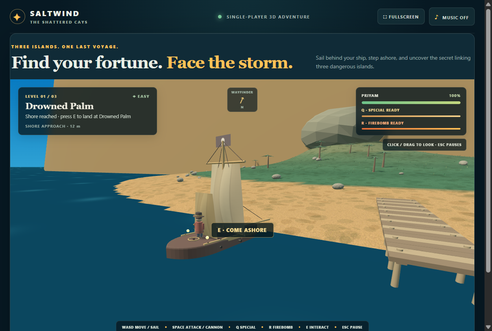

# Saltwind: The Shattered Cays

  

<strong>A single-player 3D pirate adventure across three lost islands.</strong>

  

Sail the open sea, come ashore, battle island guardians, and follow an original mystery from Drowned Palm to Thornreach and the Ember Crown. Saltwind is a self-contained browser game built with Three.js; its renderer and original synthesized score are bundled locally.

## Play

1. Download or clone this repository.
2. Open `index.html` in a current desktop browser with WebGL enabled.
3. Enter a captain name and begin the voyage.

The game runs locally without a package install or build step. If your browser restricts local files, serve this folder with any static HTTP server.

## Controls

| Input | Action |
| --- | --- |
| **W / A / S / D** | Walk on land; sail and steer at sea |
| **Click + drag** | Look around on foot; turn the ship at sea |
| **Space / left mouse** | Cutlass attack ashore; cannon at sea |
| **Q** | Storm strike ashore; broadside at sea |
| **R** | Throw a firebomb during island combat |
| **E** | Come ashore, board the ship, or claim treasure |
| **Shift** | Sprint or sail faster |
| **Esc** | Pause |

## Features

- Third-person sailing and on-foot exploration.
- Three original islands, escalating guardian fights, treasure, and a connected story.
- Rudder momentum, waves, ship bob and roll, coast collisions, and a dock for boarding.
- Cutlass attacks, cannon fire, storm strikes, and throwable firebombs.
- Original procedural scenery, characters, sound effects, and locally synthesized music.

## Project files

- `index.html` — entry screen and game UI.
- `game.js` — Three.js world, gameplay, combat, and audio.
- `styles.css` — responsive interface.
- `three.min.js` — locally bundled Three.js r128.
- `assets/` — project emblem and gameplay screenshot.
- `THREE-LICENSE.txt` — Three.js license.

The world and story are original fan-made work, not official *Pirates of the Caribbean* content. No film characters, movie dialogue, or movie soundtrack are included.
